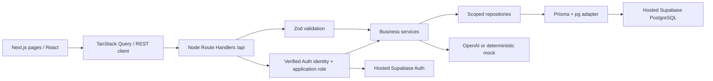
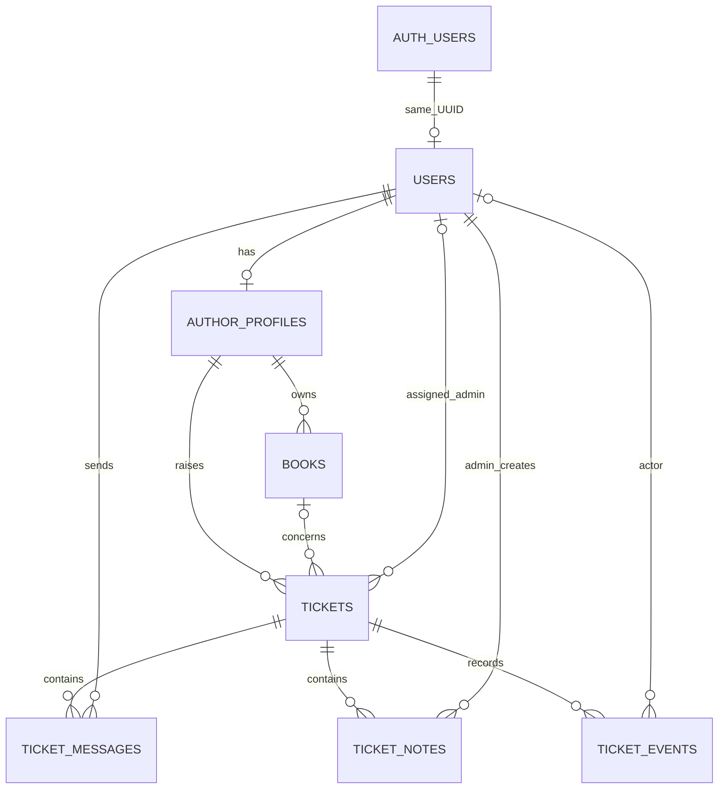

# Architecture

## Implementation status

Milestone 2 hosted setup and logins were verified/reviewed by the user. Milestone 3 implements author ticket creation/listing, public conversation and TanStack Query polling. Admin ticket management and AI are still planned. Tests distinguish mocked integration boundaries from hosted HTTP checks.

## Boundaries

- `src/app`: routes/pages and thin transport adapters; REST handlers explicitly use Node runtime.
- `src/components`, `src/features`: presentation, typed REST clients/query hooks. Browser Supabase factory is Auth-only.
- `src/server/auth`: server-only SSR factory, verified identity, trusted DB principal, role/ownership helpers and cookie policy.
- `src/server/services`: lifecycle, authorization-aware orchestration, transactions and audit writes.
- `src/server/repositories`, `src/server/db`: scoped queries and lazy Prisma singleton. `server-only` prevents browser imports.
- `src/server/ai`: later providers, prompts, KB selection and validation.
- `src/shared`: public-safe configuration, DTOs and utilities. Client modules do not import server runtime configuration.
- `scripts`: standalone trusted operations. Next.js environment precedence is shared by scripts and Prisma config.

Auth/book services and repositories are implemented. Ticket and AI boundaries remain placeholders. The browser Auth factory was removed: client components call REST endpoints without reading token cookies.

## Entity relationships

Seven application tables live in non-exposed `app`. Supabase owns `auth.users`; the migration adds a foreign key from `app.users.id` to that existing table but Prisma does not manage Auth tables. Auth deletion is restricted when business records exist.

| Table | Key choices |
|---|---|
| users | Auth UUID primary key, uppercase role enum with no default, normalized unique login email |
| author_profiles | Original author ID primary key, unique user UUID; exact contact values and DATE joined date |
| books | Original book ID primary key, author FK, exact source strings/platform array, Decimal money, nullable production data |
| tickets | Author FK, nullable book reference, original description, status/assignment, separate manual/AI fields, AI/cache metadata |
| ticket_messages | Public replies only; sender FK and per-sender/ticket retry key |
| ticket_notes | Private admin notes only; creator FK |
| ticket_events | Append-oriented event type, actor or system, constrained metadata usage |

Ticket categories map Prisma enum identifiers to the six exact assignment labels. Status, priority, roles, AI state/provider and audit types are PostgreSQL enums. Book status remains original source text, not the ticket-status enum.

All date-only values use DATE, application timestamps TIMESTAMPTZ(6), money Decimal(12,2). Transport will serialize money as strings and dates as YYYY-MM-DD. Source values are not recalculated or inferred.

## Constraints and indexes

- Composite `(book_id, author_id)` ticket FK references a matching book pair; null book means general account ticket.
- Source IDs and profile/user mappings unique. Login email normalized before insertion; lowercase checked in SQL.
- Unique author/ticket creation-request key and message sender/ticket/request key support replay-safe requests.
- Nonnegative book figures and nonblank bounded ticket/message/note text checked in SQL. Financial identities are not recomputed from incomplete data.
- Indexes support author lists, status/age queue, assignee/status, stable conversation/event cursors and effective AI/manual category/priority.
- Manual SQL includes `COALESCE(manual_*, ai_*)` indexes and a partial unseen-resolved-reply index. Do not create computed duplicate fields that could drift from manual precedence.

The migration adds Auth FK, checks, required array constraint, expression/partial indexes and privilege hardening beyond Prisma's schema language. Preserve these custom clauses when adding future migrations. Initial DDL is transactional. It has not been applied to hosted Supabase yet.

## Authentication and authorization model

Shared email/password login verifies identity with Supabase getUser(), then loads app.users.role by Auth UUID and returns a token-free principal/redirect. No signup or role-management endpoint exists. An Auth user without a complete app mapping is denied. Role is never inferred from Auth metadata.

Authors query only their own profile/books/tickets. Sender/author identities come from the verified principal. Admins see all tickets and are the only users who change status, notes, classification and assignment. Assignee/creator role checks belong in services because ordinary foreign keys cannot validate another row's role.

Return explicit DTOs. Author payloads never include notes, internal events, cached drafts, raw provider errors or internal admin metadata. Nested resource queries include parent ownership, not only UUID lookup. Inaccessible objects return 404; administrative operations by authors return 403.

Browser publishable keys access Auth, not application tables. Migration revokes schema/table access from PUBLIC, anon and authenticated; keep app out of Data API exposed schemas. The reviewed runtime-role SQL grants read-only author/book/user access and only required ticket/conversation writes. It grants no DDL, role modification or audit updates. Runtime RBAC still must be enforced in the backend; Prisma does not automatically run as the Supabase user's RLS identity.

Sessions use SSR HTTP-only, SameSite=Lax cookies, Secure on HTTPS. Proxy refreshes sessions before rendering, forwards changed cookies into the request and copies chunks/deletions onto the response. It does not authorize access: pages/APIs independently verify identity and DB role. Read-only Server Components rely on proxy cookie persistence. Login/logout require the configured Origin; JSON input is strict and capped at 16 KiB. API responses are no-store. Tokens never enter API responses or browser localStorage.

Logout revokes the current refresh session and clears all cookie chunks even on remote failure. Already-issued JWTs may remain valid until expiry; this is not immediate global revocation. The author page uses scoped queries. Admin overview requires ADMIN. Book detail uses a query containing ownership; invisible books return 404 and author-supplied author filters return 403. Future ticket services must reuse these policies.

## Trusted provisioning and source import

Milestone 2 explicitly approves the exact ten email.com logins and two configured admins for the isolated demo, superseding aliases. These are not reserved addresses. Setup reads initial passwords from environment, and administrators have no profiles. Both share identical ADMIN permissions.

Standalone scripts alone import service-role credentials and DIRECT_URL. They check target/reference approval, email-block acknowledgement, signup disabled, migration checksums, installed reviewed no-mail function and restricted runtime permissions before Auth creation. The Send Email hook must also be activated in the dashboard: function presence cannot prove activation. Provisioning remains blocked while acknowledgement is false.

New confirmed Auth users receive a server-controlled app_metadata.bookleaf_demo marker (version/project/kind/source ID). It supports reconciliation, not runtime authorization. Existing matching emails without that exact marker are rejected. Inventory checks prevent unexpected accounts, role promotion, UUID/profile reassignment and changed book owners.

Auth creation precedes a short serializable user/profile transaction. After DB failure, rerun reuses the marked identity and completes its mapping, without resetting passwords or deleting accounts. Source import separately upserts eighteen books and exact profile fields, never tickets/messages/notes/events. Verification checks twelve Auth/app users, ten profiles, two admins without profiles, all relationships and every source value including Decimal equality, dates, nulls and array order.

users.id is the Auth security identity; author_profiles.author_id retains the original business key referenced by books. These identifiers deliberately serve different purposes.

## Planned data flows and consistency

Creation: verify author -> validate owned book -> transaction inserts ticket OPEN/event -> commit -> one bounded awaited classification call -> update AI fields/event. Provider failure keeps ticket accessible for manual triage.

Public reply: verify parent visibility -> serialize with status change on the ticket row -> reject CLOSED -> insert message/event atomically -> mark resolved-author reply attention without changing status. Duplicate request IDs replay rather than insert twice; conflicting replay bodies should return 409.

Admin changes: role check -> short transaction for changed fields/events. Assignment and messages never imply status changes. Acknowledgement compares the observed reply timestamp so it cannot hide a newer reply.

Draft: admin-only explicit POST -> context fingerprint/cache lookup -> conditional in-flight claim -> bounded provider request outside transaction -> cache save only if claim/context still match. Admin edits locally, then explicitly sends submitted text through the ordinary message endpoint. Polling does not regenerate drafts.

Use row-level serialization only for concrete mutation races. No general ticket version framework or attempt table. Timestamp claims deduplicate paid work and guard stale results; manual fields are never part of AI update payloads.

## Trade-offs and extensions

Polling (5 seconds detail / 15 seconds list while visible) avoids connection infrastructure. A short awaited AI call adds creation latency but avoids unreliable serverless background promises. A fixed versioned KB needs deterministic section selection, not vector search.

Hosted-only local development reduces setup cost but needs internet/service access. Keep environments separate and require explicit migration targets. Auth provisioning and Prisma seeding are separate recoverable operations, not one transaction.

Ticket links and private Cloudflare R2 attachments are deferred as independent tables. Their future access derives from existing ticket ownership and cannot expand it. See the revised plan for upload/download controls. No royalty accounting ledger, banking integration, stock-sync action, email notification system or operational escalation integration is planned for the core assignment.
